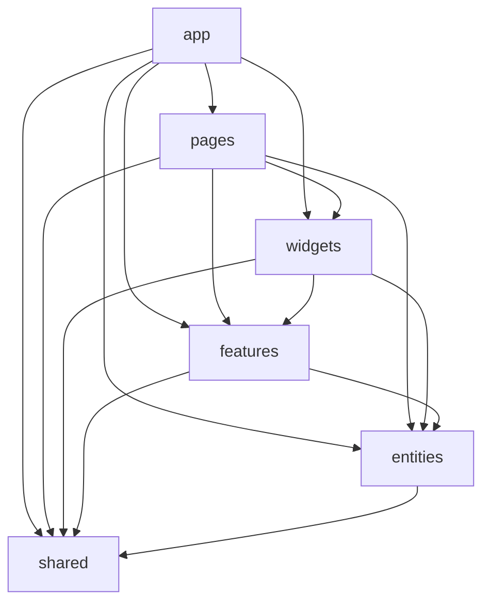

# Lottery App

Навчальний застосунок Vue 3 для керування користувачами. Проєкт використовує
TypeScript, Composition API, Feature-Sliced Design, Pinia, PrimeVue та DummyJSON.

## Запуск

Відкрийте термінал саме в папці `vue-lottery-app`:

```sh
npm install
npm run dev
```

Vite надрукує адресу локального сервера (типово `http://localhost:5173/`).
Команди перевірки:

```sh
npm run build
npm run lint:fsd
```

Якщо запускаєте з батьківської папки `lab4`, спершу виконайте
`cd vue-lottery-app`. Саме в цій папці лежить `package.json`.

API задається змінною `VITE_API_URL` у `.env`; приклад є у `.env.example`.
За замовчуванням використовується `https://dummyjson.com`.
Демо-акаунт DummyJSON: `emilys` / `emilyspass`.

## Структура та залежності FSD



Кожен слайс експортує зовнішні модулі через `index.ts`. Pinia stores
використовують Composition API; сторінки та віджети отримують дані через stores,
а не викликають сервіси напряму. Сервіси створюються в `app/providers/services.ts`,
HTTP-клієнт і універсальний `ServiceProvider` належать до `shared/api`.

UI-компоненти PrimeVue імпортуються окремо в `shared/ui`; провайдер PrimeVue,
ConfirmationService і ToastService налаштований у `app/providers/ui.ts`.
Тема зберігається через `pinia-plugin-persistedstate`. Сесійний store вручну
записує токени та профіль у `localStorage`, щоб HTTP-клієнт міг оновлювати токен
і коректно скидати сесію після помилки авторизації.

Steiger перевіряє структуру й залежності FSD. Два вузькі винятки в
`steiger.config.ts` залишають обов'язкові для лабораторної імена
`app/providers` та `widgets/users-table`; решта рекомендованих правил активна.

## Можливості

- маршрутизація, захищені сторінки користувачів і сторінка 404;
- вхід, вихід, збереження сесії та оновлення access token;
- пошук і пагінація користувачів через query-параметри;
- створення, редагування, перегляд і видалення користувачів;
- валідація форм через VeeValidate та Zod;
- сповіщення про результати операцій, підтвердження видалення;
- перемикач світлої/темної теми.

DummyJSON імітує зміни даних: CRUD-операції відображаються у стані застосунку,
але не зберігаються на сервері.
